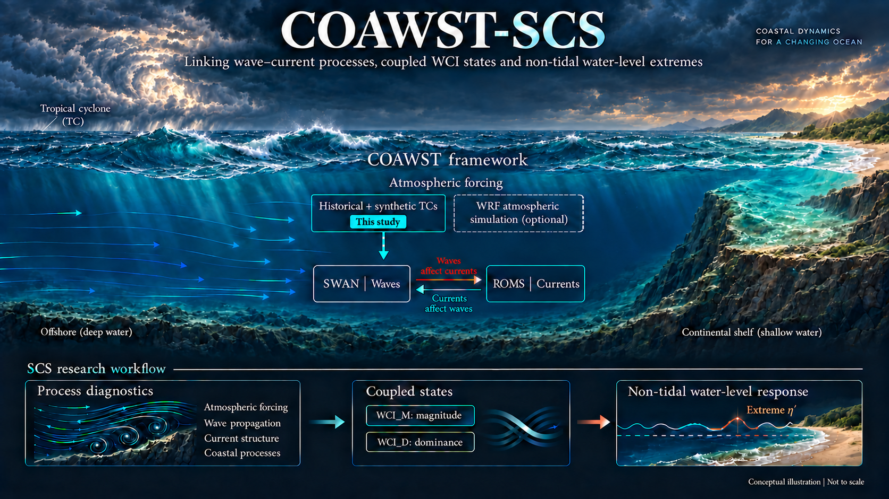

# COAWST-SCS

[](https://thushiyang.github.io/COAWST-SCS/)

COAWST-SCS investigates how wave–current interactions shape non-tidal water-level extremes during tropical cyclones (TCs) in the South China Sea. Built on the COAWST modeling framework, it combines coupled simulations and controlled process-isolation experiments to link wave–current processes, coastal dynamics and water-level responses.

[Project homepage](https://thushiyang.github.io/COAWST-SCS/) · [COAWST source repository](https://github.com/DOI-USGS/COAWST)

## Contents

```text
README.md                  Project overview
index.html                 Project homepage
assets/                    Conceptual illustration and website assets
src/
├── coawst/                Local COAWST source archive
└── scs/                   SCS case scripts, headers and configurations
out/                       Approved figures and clean redraw packages
├── Fig01/
├── Fig02/
├── Fig03/
└── …
doc/                       Environment, compilation and execution notes
```

## Model resources

- [COAWST source archive](src/coawst/index.html)
- [CPL-0 configuration archive](src/scs/H1P2_CPL0_configuration.zip)
- [Local environment and execution](doc/LOCAL_ENVIRONMENT_AND_RUN.md)

## Figure reproduction

Each figure directory is intended to contain one approved PNG, one standalone Python
plotting script and one minimal derived data file. The six figure packages are being
prepared locally and are not included in this public release.
Raw simulation data and historical figure iterations are excluded.

## Team

Contributing authors: Yang SHI (yangshi@nus.edu.sg); Zhengyu HU (z.hu@u.nus.edu);
Ying Min Low (ceelowym@nus.edu.sg); Yuzhu Pearl LI (pearl.li@nus.edu.sg).

Corresponding author: Yuzhu Pearl LI (pearl.li@nus.edu.sg).

Organization: [National University of Singapore](https://nus.edu.sg/).

## Copyright

Please follow the official COAWST citation guidance and the
[COAWST license](https://github.com/DOI-USGS/COAWST/blob/main/LICENSE.md), including the
respective licenses of its components. This website documentation is licensed under
[CC BY 4.0](https://creativecommons.org/licenses/by/4.0/).

